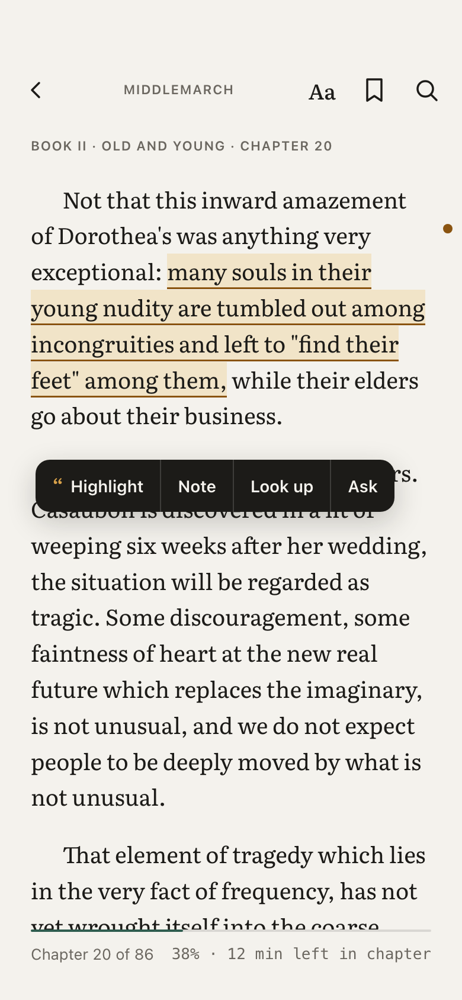
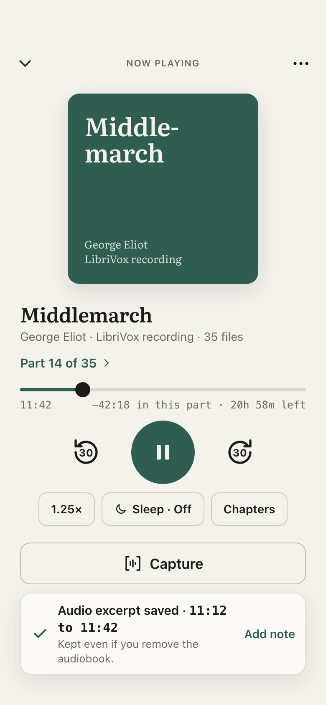
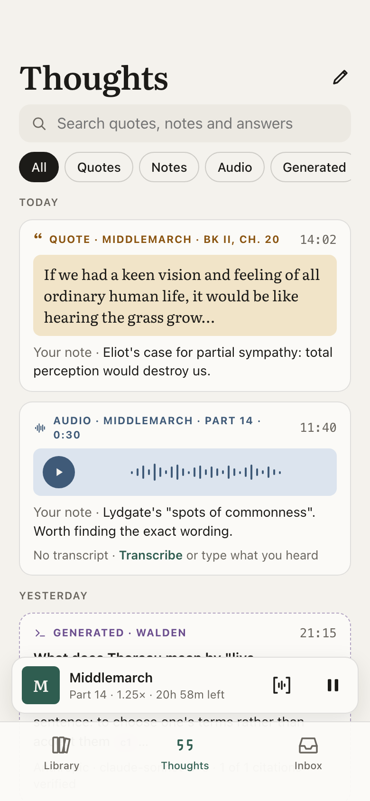

# Sylvia

**Your library of thought.**

Sylvia is a native reading and listening app in development for iPhone and iPad. It brings books, highlights, audio moments, notes and questions into one lasting, searchable record—so what you learn stays with you, even after you remove the original files.

## Why Sylvia

What we're building:

- **Keep what matters.** Preserve quotes, notes, audio excerpts and reading history after removing a downloaded book or audiobook.
- **Capture without losing your place.** Save a passage or audio moment, add your thinking and return to reading or listening.
- **Keep the source close.** Connect each saved thought to its work, edition, chapter, page or timestamp, with a way back when the source is available.
- **Ask questions in context.** Explore a passage with an optional AI provider you choose. Keep the question, answer and supporting evidence together, with generated explanations clearly distinguished from quotations.
- **Own your library.** Read and listen offline without a mandatory account or server. Export your retained knowledge, and choose what context you share with AI.

## Design samples

Concept designs in **Marginalia**, Sylvia's visual language: warm paper, readable typography and distinct treatments for quotations, personal notes, audio and generated answers.

<table>
  <tr>
    <td align="center"> Read and annotate</td>
    <td align="center"> Listen and capture</td>
    <td align="center"> Return to what you learned</td>
  </tr>
</table>

[Explore the full design gallery](Docs/Design/README.md), including dark mode, iPad, the Mac companion and grayscale studies.

## Where we're headed

**First: native iOS V1.** EPUB/PDF reading, local audiobook playback, durable capture, optional contextual AI, a permanent reading and listening record, and a lightweight Mac companion for importing your files. English and DRM-free content come first.

**Later:** saved articles and feeds, a web reader, broader capture options and an optional self-hosted hub. These are separate roadmap workstreams after V1.

## Project status

Sylvia is in design and feasibility development; there is no released app yet. The main branch contains the product plans and concept designs. Native feasibility prototypes and their evidence are maintained separately on [m0-integrate](https://github.com/jevidon/sylvia/tree/m0-integrate).

- [Product brief](Docs/Sylvia_Product_Brief.md) — the problem, audience and product vision.
- [Implementation plan](Docs/Sylvia_v1_iOS_Implementation_Plan.md) — V1 scope, milestones, acceptance criteria and roadmap.
- [Companion vision](Docs/Sylvia_Companion_Vision_Architecture_Addendum.md) — the longer-term direction for learning beyond files stored in Sylvia.
